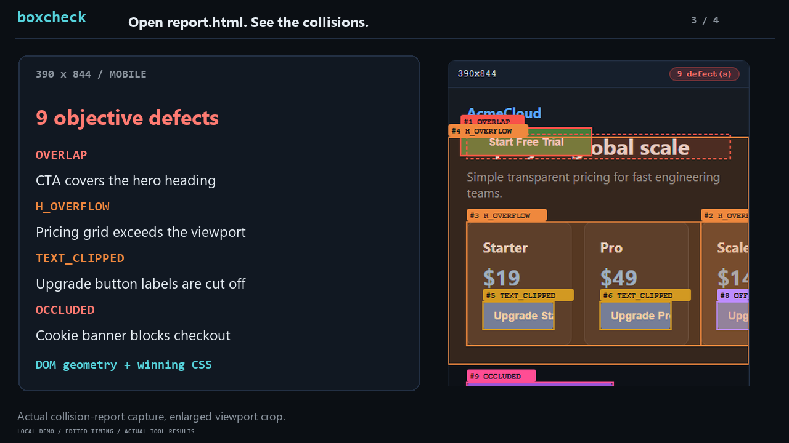
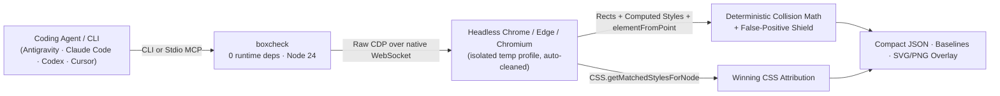

# boxcheck

**100% local DOM geometry, CSS cascade, and layout-collision oracle (CLI + MCP) so coding agents stop shipping broken mobile UIs. Speaks raw CDP over Node 24 WebSocket with zero runtime dependencies.**

[](./LICENSE)
[](https://nodejs.org)
[-informational.svg)](#architecture)

[](https://github.com/flipcyde101/boxcheck/releases/download/v0.1.0/boxcheck-demo.mp4)

[Watch the 15-second boxcheck demo (MP4)](https://github.com/flipcyde101/boxcheck/releases/download/v0.1.0/boxcheck-demo.mp4)



---

## See It Catch Mobile Layout Bugs Locally (Zero Setup)

```bash
npx boxcheck --demo --json --out ./boxcheck-report.html
```

Spins up a built-in responsive SaaS pricing page (0 defects on `1440x900` desktop, mobile collisions on `390x844`), audits it in local headless Chrome via raw CDP, prints compact deterministic collision JSON with winning CSS rules, and writes a self-contained visual SVG/PNG overlay report to `./boxcheck-report.html`.

---

## Quick Start

```bash
# Audit mobile + desktop viewports
npx boxcheck audit http://localhost:3000 --vp 390x844,1440x900 --json

# Generate visual SVG/PNG collision overlay report
npx boxcheck audit http://localhost:3000 --vp 390x844 --out ./report.html

# Save lightweight git-committable JSON geometry baselines (.boxcheck/baselines/)
npx boxcheck snap http://localhost:3000

# Diff live geometry against baseline (flags unintended >2px shifts/resizes)
npx boxcheck diff http://localhost:3000 --fail-on-defects
```

---

## Connect to Your Coding Agent (Stdio MCP)

`boxcheck mcp` exposes three lean tools (`boxcheck_audit`, `boxcheck_snap`, `boxcheck_diff`) returning compact deterministic JSON instead of giant accessibility tree dumps.

### Antigravity / Cursor / Claude Code / Codex / OpenCode

```json
{
  "mcpServers": {
    "boxcheck": {
      "command": "npx",
      "args": ["-y", "boxcheck", "mcp"]
    }
  }
}
```

---

## What `boxcheck` Detects (with Built-In False-Positive Shield)

| Defect Kind | Deterministic Condition | False-Positive Shield |
|---|---|---|
| `OVERLAP` | Non-ancestor content/interactive siblings intersect `>=4px` on both axes (`>=24px²`) | Ignores ancestor-descendant pairs, `pointer-events: none`, `aria-hidden`, `inert`, `sticky`/`fixed` layers, small corner badges, `<4px` subpixel jitter |
| `H_OVERFLOW` | Page `scrollWidth > clientWidth` + protruding elements past viewport edge | Skips intentional `overflow-x: auto/scroll/hidden` containers and their scrollable children; deduplicates ancestor/descendant chains |
| `TEXT_CLIPPED` | Text exceeds `overflow: hidden/clip` box by `>=6px` | Ignores intentional `text-overflow: ellipsis` and `-webkit-line-clamp` truncation |
| `OFF_SCREEN` | Visible interactive element pushed `>50%` outside horizontal viewport | Ignores elements inside horizontal scroll containers, clipped/hidden/zero-opacity nodes |
| `OCCLUDED` | `elementFromPoint(cx, cy)` hits an unrelated higher z-index blocker | Ignores self, descendants, ancestors, and elements clipped out by scroll ancestors |

Each defect is enriched via CDP `CSS.getMatchedStylesForNode` with the exact deduplicated `winning_css` rule so your coding agent fixes the root CSS line directly.

---

## Honest Comparison

| Feature | `boxcheck` | Playwright MCP | `agent-browser` | Chromatic / Percy |
|---|---|---|---|---|
| **Install & Footprint** | ~52 kB tarball, **0 runtime deps**, uses system Chrome/Edge | Heavy browser bundle | Node + browser | Paid cloud SaaS + CI |
| **Output size per layout check** | Compact JSON capped for small agent context budgets | Large a11y trees / PNGs | Navigation-focused refs | N/A (human PR review) |
| **Deterministic overlap / overflow / occlusion math + `winning_css`** | **Yes** | No | No | Pixel diff only |
| **Git-committable JSON geometry baselines** | **Yes** (tiny `.json`) | No | No | Cloud PNG storage |
| **Where competitors win** | (Chromium-only layout oracle) | Full interactive clicking, form filling, E2E scripting | Multi-step web navigation | Cross-browser Safari/Firefox cloud visual approval workflows |

---

## Architecture



---

## Local Agent Reliability Suite

- **[kvdiff](https://github.com/flipcyde101/kvdiff)**: Zero-code local proxy that pinpoints the exact UTF-8 byte breaking your LLM prompt cache (`Anthropic`, `OpenAI`, `Gemini/Antigravity`, `llama.cpp`/vLLM).
- **boxcheck** *(this repo)*: Local DOM geometry & CSS collision oracle (CLI + MCP).

## License

[MIT](./LICENSE)
